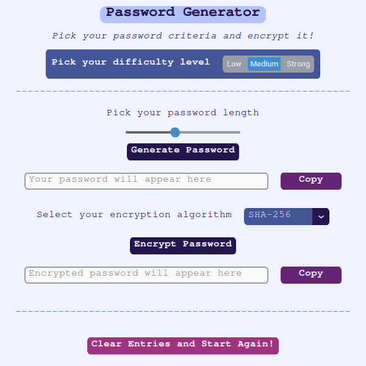
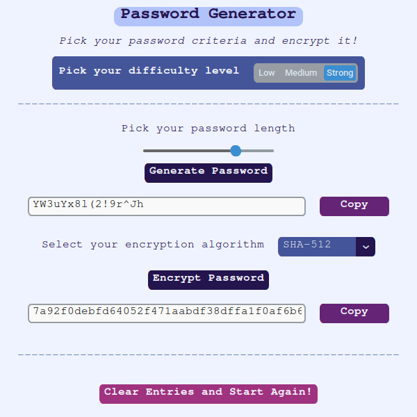

# 🔐 · · Password Generator & Encryptor

A small desktop app made with Python and [CustomTkinter](https://github.com/TomSchimansky/CustomTkinter).
Pick how strong and how long you want your password, generate it, then run it through an encryption or hashing algorithm, all in one user-friendly window!

## 🖥️ · · Screenshots




## 🧃 · · Features

- **3 difficulty levels**
  - **Low**: lowercase letters only
  - **Medium**: lowercase + uppercase letters
  - **Strong**: lowercase + uppercase letters, digits and symbols
- **Adjustable length**: anywhere from 6 to 20 characters with a slider
- **4 algorithms to choose from**
  - **SHA-256**
  - **SHA-512**
  - **MD5**
  - **Caesar cipher** (shifts every character by 3)
- **Copy buttons** for both the password and its encrypted version
- **Clear button** to wipe both fields and start again

## 📁 · · Requirements

- Python 3.8 or newer
- CustomTkinter

## 🧩 · · Getting Started

1. Clone the repository
   ```bash
   git clone https://github.com/Gemmiee/password-generator-and-encryptor.git
   cd password-generator-and-encryptor
   ```
2. Install CustomTkinter
   ```bash
   pip install customtkinter
   ```
3. Run the app
   ```bash
   python password_generator.py
   ```

## 🏝️ · · How to Use

1. Pick a difficulty level: **Low**, **Medium** or **Strong**
2. Drag the slider to choose the password length
3. Click **Generate Password**
4. Choose an algorithm from the dropdown menu
5. Click **Encrypt Password** to see the result
6. Use the **Copy** buttons to copy either one, or **Clear Entries** to start over

## 💛 · · Built With

- 🐍 Python
- 🎨 CustomTkinter for the interface
- 🔢 `hashlib` for SHA-256, SHA-512 and MD5
- 🎲 `random` for generating the passwords
